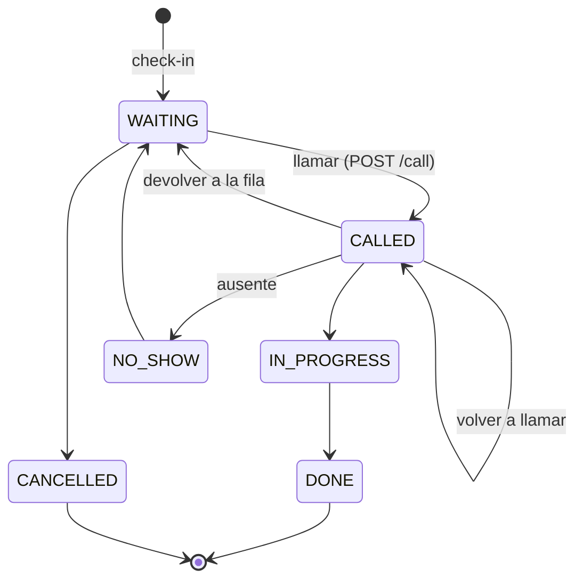

# 04 · Contratos

Fuente de verdad en código: [`libs/shared/contracts`](../libs/shared/contracts) (`@vitalia/contracts`). Este documento lo resume para quien no lee TypeScript (firmware, portal, tesis). Si cambia algo, se actualizan **los dos**.

## REST (`/api`)

Swagger interactivo: `http://localhost:3000/api/docs`.

Autenticación: header `Authorization: Bearer <accessToken>` en todo endpoint salvo los marcados como **público**. Roles: `ADMIN`, `NURSE`, `DOCTOR`, `RECEPTION`.

| Método | Ruta                                     | Acceso                       | Descripción                                                                                                                                      | Estado     |
| ------ | ---------------------------------------- | ---------------------------- | ------------------------------------------------------------------------------------------------------------------------------------------------ | ---------- |
| GET    | `/api/health`                            | público                      | Estado del gateway, PostgreSQL y MQTT (`HealthResponse`)                                                                                         | ✅ F2      |
| POST   | `/api/auth/login`                        | público (5/min por IP)       | Login del personal → `LoginResponse` (JWT de 8 h)                                                                                                | ✅ F1      |
| GET    | `/api/auth/me`                           | staff                        | Usuario autenticado (`StaffUser`)                                                                                                                | ✅ F1      |
| GET    | `/api/services`                          | público                      | Servicios de atención (`ServiceArea[]`) para elegir en el check-in                                                                               | ✅ F1      |
| GET    | `/api/consulting-rooms`                  | staff                        | Consultorios activos (`ConsultingRoom[]`)                                                                                                        | ✅ F1      |
| POST   | `/api/check-in`                          | público (10/min por IP)      | Check-in (`CheckInRequest`) → `PublicTicket`. Idempotente por DNI                                                                                | ✅ F1      |
| GET    | `/api/tickets?status=&serviceCode=`      | staff                        | Fila del día (por defecto, turnos abiertos), ordenada por triaje y llegada (`Ticket[]`)                                                          | ✅ F1      |
| GET    | `/api/tickets/:id`                       | staff                        | Detalle de un turno (`Ticket`)                                                                                                                   | ✅ F1      |
| GET    | `/api/tickets/:id/public`                | público                      | Estado para el paciente (`PublicTicket`: posición y espera estimada)                                                                             | ✅ F1      |
| GET    | `/api/tickets/recent-calls?serviceCode=` | público                      | Últimos 6 llamados del día para la TV (`RecentCallsResponse`, sin datos clínicos); `serviceCode` filtra una TV por servicio                      | ✅ F3 · F5 |
| GET    | `/api/tickets/:id/readings?minutes=`     | staff                        | Curva de signos vitales del turno (`VitalsHistory`): promedios por intervalo (≤ 600 puntos), caídas y alertas. `minutes` 1–1440, 120 por defecto | ✅ F5      |
| POST   | `/api/tickets/:id/call`                  | `DOCTOR` · `NURSE` · `ADMIN` | Llamar a un consultorio (`CallTicketRequest`)                                                                                                    | ✅ F1      |
| PATCH  | `/api/tickets/:id/status`                | staff                        | Cambiar el estado (`UpdateTicketStatusRequest`) según las transiciones permitidas                                                                | ✅ F1      |
| PATCH  | `/api/tickets/:id/triage`                | `NURSE` · `DOCTOR` · `ADMIN` | Triaje manual (`UpdateTriageRequest`)                                                                                                            | ✅ F1      |
| GET    | `/api/wearables`                         | staff                        | Pulseras con turno, conexión (`online`), sala y última lectura (`Wearable[]`)                                                                    | ✅ F2      |
| GET    | `/api/wearables/:id`                     | staff                        | Detalle de una pulsera (`Wearable`)                                                                                                              | ✅ F2      |
| POST   | `/api/wearables`                         | `ADMIN` · `NURSE`            | Alta (`CreateWearableRequest`): código `wb-<NN>-<mac>` y número sin repetir → 409                                                                | ✅ F2      |
| PATCH  | `/api/wearables/:id`                     | `ADMIN` · `NURSE`            | Etiqueta y estado (`UpdateWearableRequest`: `AVAILABLE` ↔ `MAINTENANCE`). Asignada → 409: liberala primero                                       | ✅ F5      |
| POST   | `/api/wearables/:id/assign`              | staff                        | Asignar a un turno abierto (`AssignWearableRequest`). Si ya lo llamaron, va al OLED                                                              | ✅ F2      |
| POST   | `/api/wearables/:id/release`             | staff                        | Liberar la pulsera (también se libera sola al finalizar o cancelar el turno)                                                                     | ✅ F2      |
| GET    | `/api/alerts?active=true`                | staff                        | Alertas activas (`active=false`: las últimas 100 de cualquier estado) (`Alert[]`)                                                                | ✅ F2      |
| POST   | `/api/alerts/:id/ack`                    | staff                        | Reconocer una alerta → `Alert` y `alert:acknowledged`. Ya reconocida → 409. Recién emitida y todavía sin guardar (pocos ms) → 404                | ✅ F2      |
| GET    | `/api/sync/status`                       | `ADMIN`                      | Estado de la réplica a la nube (`SyncStatus`: pendientes, último envío, error, próximo intento)                                                  | ✅ F5      |

### Ciclo de vida del turno



Una transición inválida responde **409 Conflict**. La regla está en `TICKET_TRANSITIONS` / `canTransition()` de `@vitalia/contracts`.

### Errores

Formato estándar de NestJS: `{ "statusCode": 400, "message": "…" | ["…"], "error": "Bad Request" }`. Los mensajes de validación están en español para mostrarlos tal cual en el portal o el Backoffice. 401: falta el token o es inválido · 403: rol sin permiso · 404: no existe · 409: transición inválida · 429: demasiados intentos.

### Ejemplos

```http
POST /api/check-in
{ "firstName": "Lucía", "lastName": "Gómez", "documentNumber": "30123456",
  "serviceCode": "CLINICA", "source": "CAPTIVE_PORTAL", "reason": "Fiebre" }

201 → { "id": "…", "code": "A-009", "status": "WAITING", "serviceName": "Clínica Médica",
        "consultingRoomName": null, "position": 4, "estimatedWaitMinutes": 48,
        "checkedInAt": "2026-10-03T22:35:02.559Z", "calledAt": null }
```

### `GET /api/health`

```json
{
  "status": "ok",
  "service": "vitalia-api",
  "version": "0.1.0",
  "environment": "development",
  "uptimeSeconds": 42,
  "timestamp": "2026-10-03T22:00:00.000Z",
  "checks": [
    { "name": "process", "status": "ok" },
    { "name": "database", "status": "ok" },
    { "name": "mqtt", "status": "ok" }
  ]
}
```

- `database` caída → `down`.
- `mqtt` sin `MQTT_URL`, sin conexión o sin `TELEMETRY_AES_KEY` → `degraded` con `detail`: los turnos siguen funcionando, pero no entran lecturas ni alertas.

## Tiempo real (Socket.IO, path `/socket.io`)

Constantes: `REALTIME_EVENTS`, `REALTIME_ROOMS`, `REALTIME_READY_EVENT`, `REALTIME_ERROR_EVENT`.

### Conexión (`RealtimeHandshakeAuth`)

La sala se elige con el `auth` del handshake:

```ts
io({ path: '/socket.io', auth: { token: accessToken } }); // personal → sala staff
io({ path: '/socket.io', auth: { role: 'tv' } }); // pantalla llamadora → sala tv
io({ path: '/socket.io', auth: { ticketId } }); // paciente → sala patient:<ticketId>
```

- Al unirse, el servidor emite `realtime:ready` `{ room }`. Recién ahí empiezan a llegar eventos.
- Un token inválido o un `auth` sin ninguno de esos campos recibe `realtime:error` `{ message }` y se desconecta.
- CORS: los mismos orígenes que la API REST (`CORS_ORIGINS`).

### Eventos

| Evento               | Salas                               | Payload                                                                                                                                              | Estado     |
| -------------------- | ----------------------------------- | ---------------------------------------------------------------------------------------------------------------------------------------------------- | ---------- |
| `ticket:called`      | `tv`, `staff`, `patient:<ticketId>` | `TicketCalledEvent { ticketId, ticketCode, serviceCode?, consultingRoom, professionalName?, calledAt }`: la TV por servicio filtra por `serviceCode` | ✅ F2 · F5 |
| `queue:updated`      | `staff`, `tv`                       | `QueueUpdatedEvent { change, ticketId, ticketCode, serviceCode, status, waitingCount, at }`: aviso para re-consultar                                 | ✅ F2      |
| `telemetry:reading`  | `staff`                             | `TelemetryReadingEvent { wearableId, ticketId, ticketCode, reading, assessment, receivedAt }`                                                        | ✅ F2      |
| `alert:emergency`    | `staff`                             | `AlertEmergencyEvent { alertId, wearableId, ticketId?, patientId?, ticketCode?, kind, level, message, detectedAt }`                                  | ✅ F2      |
| `alert:acknowledged` | `staff`                             | `AlertAcknowledgedEvent { alertId, by: { id, fullName }, at }`                                                                                       | ✅ F2      |

- Los signos vitales **solo** se emiten a la sala `staff`. `queue:updated` no lleva triaje ni datos del paciente (lo ve la TV).
- `change` de `queue:updated`: `CHECK_IN`, `CALLED`, `STATUS` o `TRIAGE` (manual o escalado por la telemetría).
- `detectedAt` de una alerta es la hora del wearable (`reading.ts`): la latencia de punta a punta se mide contra ese valor.

### Ingesta y alertas

1. Sobre → AES-256-GCM → validación → `wearableId` = `<id>` del tópico → pulsera dada de alta → deduplicación por `seq`.
2. `vitalsFindings()` (contracts) da los hallazgos con su tipo; `assessVitals()` los resume en nivel y motivos.
3. Se emite `telemetry:reading` y, por cada hallazgo **CRÍTICO**, `alert:emergency`, **antes** de escribir en la base.
4. Se persisten la lectura (`ON CONFLICT DO NOTHING`), la alerta, `last_seen_at`/`last_room` de la pulsera y, si corresponde, el triaje del turno.

- Una alerta del mismo tipo (`kind`) para la misma pulsera no se repite mientras siga `ACTIVE`. Al reconocerla, el próximo hallazgo abre una nueva.
- El triaje del turno **solo sube** por la telemetría. Bajarlo es decisión del personal (`PATCH /api/tickets/:id/triage`).
- Se descartan, con un warning en el log (sin el contenido): tag inválido, JSON o campos fuera del contrato, rangos imposibles, `wearableId` distinto del tópico y códigos que no existen en `wearables`.

## MQTT (Mosquitto, puerto 1883, QoS 1)

| Tópico                               | Dirección             | Contenido                              |
| ------------------------------------ | --------------------- | -------------------------------------- |
| `hospital/<sala>/wearable/<id>/data` | wearable → gateway    | Sobre cifrado con la lectura           |
| `hospital/<sala>/wearable/<id>/cmd`  | gateway → wearable    | Comando (ej. mostrar turno en el OLED) |
| `hospital/+/wearable/+/data`         | suscripción de la API | —                                      |

### Identificador del wearable

`<id>` = `wearableId` = `wearables.code` = **`wb-<NN>-<mac>`**, por ejemplo `wb-07-24d7cc` ([ADR 0011](adr/0011-identificador-del-wearable.md)).

- `NN`: número físico de la pulsera, de 01 a 99. En el firmware es `WEARABLE_NUMBER`, en `secrets.h`.
- `mac`: últimos 3 bytes de la MAC Wi-Fi, en hex minúscula.
- En código: `WEARABLE_CODE_PATTERN`, `formatWearableCode()` y `parseWearableCode()` de `@vitalia/contracts`.
- Desde 4b, el código también es el usuario de Mosquitto en el gateway. Su contraseña individual se aprovisiona localmente; la carga al firmware queda manual.

### Identidades y permisos (gateway 4b)

`WearableMqttPasswords` y `parseWearableMqttPasswords()` definen y validan el archivo local de códigos y contraseñas (16–128 caracteres, sin controles ni `:`). No es un endpoint REST ni un payload de telemetría. El aprovisionador y el simulador lo comparten sin incorporar secretos a los builds.

La API puede leer todos los `.../data` y escribir `.../cmd`; cada pulsera solo escribe sus datos y lee sus comandos en cualquier sala; health solo lee uptime. Los demás permisos se deniegan. Aprovisionamiento, altas, revocación y pruebas en [09-despliegue-gateway.md](09-despliegue-gateway.md#seguridad-mqtt-4b), decisión en [ADR 0014](adr/0014-identidades-y-acl-mqtt.md). Los mensajes y el cifrado existentes se conservan.

### Sobre cifrado (`EncryptedEnvelope`)

```json
{ "v": 1, "iv": "<12 bytes base64>", "ct": "<base64>", "tag": "<16 bytes base64>" }
```

- Algoritmo **AES-256-GCM**. Clave de 32 bytes compartida (`TELEMETRY_AES_KEY`, 64 hex). IV aleatorio por mensaje ([ADR 0006](adr/0006-cifrado-aes-256-gcm.md)).
- Si el tag no valida, el mensaje se descarta.
- **Sin AAD**: el campo `v` viaja en claro y no forma parte de la autenticación.
- **El `wearableId` descifrado tiene que coincidir con el `<id>` del tópico**; si no, el mensaje se descarta. El sobre no lleva AAD y la clave es una sola para todas las pulseras: sin este chequeo, un sobre válido de una pulsera publicado en el tópico de otra pasaría como bueno. A futuro (`v: 2`), el tópico puede ir como AAD.

**Implementación de referencia del descifrado y la validación:** `tools/scripts/mqtt-check.ts` (`pnpm fw:mqtt-check`). El tópico `<…>/data/plain` que el firmware puede publicar en desarrollo (`MQTT_DEBUG_PLAINTEXT`) **no es parte del contrato**.

#### Vectores de prueba compartidos

`GCM_TEST_VECTORS` de `@vitalia/contracts` (`telemetry/gcm-test-vectors.ts`) es la fuente única de vectores AES-256-GCM:

| Vector                    | Qué prueba                                                         |
| ------------------------- | ------------------------------------------------------------------ |
| `nist_tc15`               | Vector oficial del NIST (AES-256, IV de 96 bits, sin AAD)          |
| `vitalia_reading`         | Un `TelemetryReading` de `wb-01-24d7cc`, también en forma de sobre |
| `vitalia_reading_bad_tag` | Tag alterado: el descifrado **tiene que fallar**                   |

- El spec de contracts los verifica con `node:crypto`.
- Se importan desde **`@vitalia/contracts/testing`**, no desde el barrel principal, así Backoffice, TV y portal no los ven.
- La API los usa en los tests de descifrado del módulo `telemetry`.
- El firmware los recibe en `apps/wearable-firmware-poc/test/fixtures/gcm_vectors.h`, generado con `pnpm fw:codegen`. La CI corre `pnpm fw:codegen --check` para que no quede desactualizado.
- La clave de los vectores (`00…1f`) es solo para tests: nunca usarla como `TELEMETRY_AES_KEY`.

### Lectura en claro (`TelemetryReading`)

```json
{
  "wearableId": "wb-07-24d7cc",
  "seq": 1532,
  "ts": 1791065563577,
  "hr": 78,
  "spo2": 98,
  "temp": 36.6,
  "accPeakG": 1.02,
  "fall": false
}
```

| Campo      | Unidad   | Notas                                                                                     |
| ---------- | -------- | ----------------------------------------------------------------------------------------- |
| `seq`      | —        | Monotónico, también entre reinicios (ver abajo); la API deduplica por `(wearableId, seq)` |
| `ts`       | ms epoch | Hora del wearable (NTP; ver nota de red en 01-arquitectura)                               |
| `hr`       | BPM      |                                                                                           |
| `spo2`     | %        |                                                                                           |
| `temp`     | °C       | Ya compensada a temperatura clínica                                                       |
| `accPeakG` | g        | Pico del intervalo                                                                        |
| `fall`     | bool     | `true` si el firmware detectó una caída                                                   |

**Rangos físicos (`TELEMETRY_READING_LIMITS`):** `hr` 20–250, `spo2` 50–100, `temp` 25–45 y `accPeakG` 0–16. No son umbrales clínicos (eso es `assessVitals()`): un valor afuera es un sensor sin poner o roto. La API **descarta la lectura entera** si un campo se sale, así que el wearable no los manda fuera de rango:

- `hr`, `spo2` y `temp` se **omiten**. Ej.: con la pulsera sin poner, el MLX90614 mide el aire (~23 °C).
- `accPeakG` se **satura** en 16 g. Es la magnitud de los tres ejes, que en un golpe fuerte pasa los 16 g aunque cada eje sature ahí, y esa lectura es la que lleva `fall: true`.

#### `seq` entre reinicios

`seq = arranque × 2^24 + contador` (`composeSeq()` / `splitSeq()` de `@vitalia/contracts`, `SEQ_BOOT_SHIFT = 24`).

- El wearable guarda un contador de **arranques** en su flash (NVS): una escritura por boot.
- El **contador** de mensajes vuelve a 0 en cada arranque. Así, después de reiniciar, `seq` salta al bloque siguiente y sigue creciendo. Si arrancara de 0, la deduplicación descartaría las lecturas nuevas.
- La API puede usar `splitSeq(seq).boot` para detectar reinicios. Un salto de `counter` dentro del mismo `boot` indica mensajes perdidos.
- El simulador de wearables tiene que armar `seq` igual.

#### Constantes para el firmware

Lo que el firmware necesita del contrato (tópicos, `MQTT_QOS`, `ENVELOPE_VERSION`, `TELEMETRY_CIPHER`, `SEQ_BOOT_SHIFT`, el rango del número de wearable, `TELEMETRY_READING_LIMITS` y `CLINICAL_THRESHOLDS`) se genera en `apps/wearable-firmware-poc/include/vitalia_contracts.h` con `pnpm fw:codegen`. La CI verifica que esté al día.

### Comando al wearable (`WearableCommand`)

```json
{ "type": "SHOW_TICKET", "ticketCode": "A-024", "consultingRoom": "Consultorio 4" }
```

- La API lo publica en `hospital/<sala>/wearable/<id>/cmd` con QoS 1 y sin retain al llamar el turno que tiene la pulsera, o al asignar la pulsera a un turno ya llamado.
- `<sala>` es la de la última lectura recibida (`wearables.last_room`). Si nunca publicó, se usa `DEFAULT_WEARABLE_ROOM` (`sala1`).
- Va **en claro**: no lleva signos vitales ni datos personales, solo lo que ya muestra la TV. Desde 4b la ACL del gateway reserva la publicación en `cmd` a la API.
- Si no hay conexión con el broker, el llamado sigue igual (el OLED no se entera).

Desde 4c, el firmware se suscribe con QoS 1 a `hospital/+/wearable/<id propio>/cmd` en cada conexión, incluso al reconectar. El receptor valida el objeto completo con esos tres campos, `type` conocido y textos UTF-8 no vacíos sin controles. Los límites `WEARABLE_COMMAND_LIMITS` se generan a C++: 512 bytes de JSON, 16 de código y 320 de consultorio (sin terminadores). El formato del mensaje no cambia.

Los fragmentos se reensamblan dentro del límite; mensajes retenidos, incompletos, ajenos, desconocidos o inválidos se descartan sin cambiar el último llamado. La tarea MQTT pasa una copia por cola al `loop()`, que muestra `TE LLAMAN`, código y consultorio. Los nombres largos se desplazan y las tildes/ñ se transliteran para la fuente básica del OLED. Una caída local reciente conserva prioridad; sin broker se indica `LLAMADO SIN RED` y se conserva lo recibido. El llamado dura hasta reemplazo o reinicio: todavía no hay `CLEAR_TICKET` ni recuperación automática de llamados perdidos durante una desconexión. [ADR 0015](adr/0015-recibir-comandos-en-el-firmware.md).

## Réplica a la nube (RF-O6, ADR 0018)

El gateway envía los cambios con `POST <CLOUD_SYNC_URL>`, header `Authorization: Bearer <CLOUD_SYNC_TOKEN>` y cuerpo `SyncBatch` (`libs/shared/contracts/src/lib/sync`):

```json
{
  "gatewayId": "gateway-local",
  "sentAt": "2026-10-25T14:00:00.000Z",
  "events": [
    {
      "id": 41,
      "topic": "ticket.upsert",
      "entityId": "<uuid>",
      "occurredAt": "…",
      "payload": { "…": "Ticket" }
    },
    {
      "id": 42,
      "topic": "alert.upsert",
      "entityId": "<uuid>",
      "occurredAt": "…",
      "payload": { "…": "Alert" }
    }
  ]
}
```

- Tópicos (`SYNC_TOPICS`): `ticket.upsert` (payload `Ticket`) y `alert.upsert` (payload `Alert`). Siempre el estado completo y ya minimizado: nombre visible, nunca el DNI.
- Hasta `SYNC_BATCH_SIZE` (100) eventos por envío, en orden de `id`. La nube responde 2xx para confirmar. Cualquier otro código o un timeout de 10 s → reintento con backoff (máx. 5 min).
- Entrega al menos una vez: la nube deduplica por `gatewayId` + `id` y se queda con el `occurredAt` más nuevo por `entityId`.
- `pnpm cloud:sink` implementa este receptor para pruebas.

## Portal cautivo ↔ API

El portal cautivo se integra en el proyecto de red del equipo (fuera de este monorepo). Contrato que consume: `GET /api/services`, `POST /api/check-in` y polling o socket de `GET /api/tickets/:id/public`. Su `VITE_BASE_URL` apunta a la API del gateway (CORS ya incluye `http://localhost:5173`).
