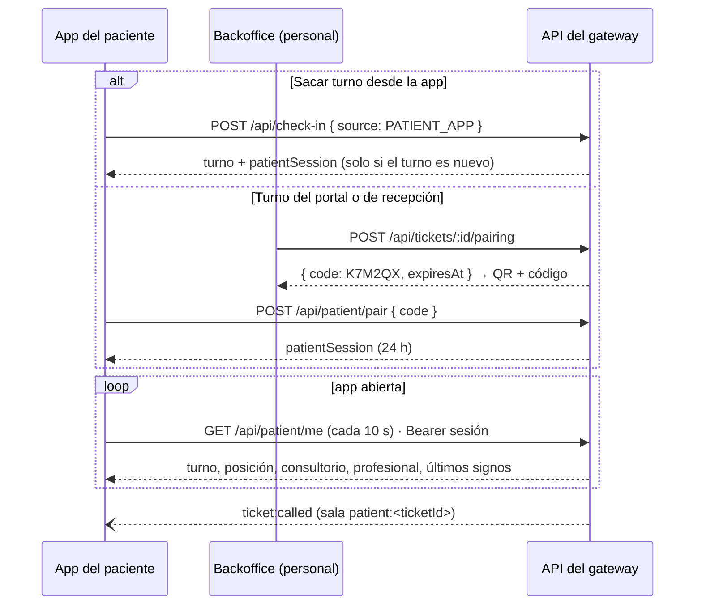

# 11 · App del paciente (Flutter · Android)

Guía completa de `apps/patient-app`: qué hace, cómo se levanta, cómo funciona por dentro y cómo se prueba. La decisión de arquitectura está en el [ADR 0019](adr/0019-app-del-paciente-en-flutter.md); las reglas para trabajar en el código, en [`apps/patient-app/AGENTS.md`](../apps/patient-app/AGENTS.md).

## Qué es

La app Android del paciente cubre RF-O5: check-in y autogestión del turno. Funciona como **turnero** y como libreta de salud personal:

| Pestaña      | Qué muestra                                                                                                                                                                                                             |
| ------------ | ----------------------------------------------------------------------------------------------------------------------------------------------------------------------------------------------------------------------- |
| **Turno**    | El turno de hoy en vivo: número, posición y espera estimada. Cuando te llaman: a qué consultorio y con qué profesional (con aviso, vibración y notificación). Debajo, «Mis visitas» y los próximos turnos de la agenda. |
| **Mi salud** | Si tenés pulsera asignada: pulso, SpO₂ y temperatura de la última lectura, su estado («En rango / A controlar / Fuera de rango») y la curva de la espera (30 min, 2 h u 8 h).                                           |
| **Agenda**   | Turnos médicos que anotás vos (en el hospital o en cualquier lado): cuándo, dónde y con quién. Te avisa 2 h antes de cada uno.                                                                                          |
| **Ficha**    | Tu ficha de salud: grupo sanguíneo, alergias, condiciones, medicación, cobertura y contacto de emergencia. Incluye la vista «Mostrar al personal», en grande y con alto contraste.                                      |
| **Ajustes**  | Dirección del servidor del hospital, turno vinculado, permiso de notificaciones y «Borrar todos mis datos».                                                                                                             |

Lo que llega del hospital (turno y signos vitales) se lee de la API del gateway por el Wi-Fi del hospital. Lo que escribe el paciente (agenda y ficha) y el historial de visitas **quedan cifrados en el teléfono y no se envían a ningún lado**.

## Requisitos

- **Flutter 3.44** (stable, Dart 3.12) en el PATH. Revisalo con `flutter doctor`; el toolchain de Android tiene que estar en verde.
- **Android Studio** con el SDK de Android (la primera compilación baja solo las plataformas que faltan) y un AVD. El equipo usa **Pixel 8 · Android 16 · x86_64**, con id `Pixel_8`.
- **Para correrla contra datos:** la API (`pnpm nx serve api` con PostgreSQL) o el gateway Docker. Para ver signos vitales, además, el simulador de pulseras (`pnpm sim:wearables`) y un broker MQTT.
- **Windows:** conviene que el repo **no esté en OneDrive** (Gradle es lento y las rutas largas fallan). Si usás `fnm` para Node, abrí la terminal con el entorno de `fnm` cargado.

El resto del monorepo no necesita Flutter: los targets de la app se llaman `flutter-*` y `nx affected -t lint test build` no los corre.

## Inicializar y correr

### En el emulador, contra la API de desarrollo

```powershell
pnpm install
pnpm infra:up              # PostgreSQL 16 + Mosquitto (Docker)
pnpm db:migrate
pnpm db:seed               # 14 turnos, 8 pulseras (4 asignadas), personal con clave Vitalia2026!
pnpm nx serve api          # http://localhost:3000 (la app la ve como http://10.0.2.2:3000)
pnpm sim:wearables         # opcional: signos vitales de las pulseras del seed

pnpm app:emulator          # levanta el AVD Pixel_8
pnpm app:run               # flutter pub get + flutter run con VITALIA_API_URL=http://10.0.2.2:3000
```

`10.0.2.2` es la PC vista desde el emulador de Android. Si la API corre en otro puerto u otra máquina:

```powershell
pnpm nx run patient-app:run --api=http://192.168.0.50:3000
```

Si tenés el emulador abierto y querés la app en otro dispositivo, `flutter devices` lista los conectados y `flutter run -d <id>` elige uno, desde `apps/patient-app`.

### Contra el gateway Docker

1. En `.gateway/.env`, publicá la web en la interfaz de la red de los pacientes: `GATEWAY_HTTP_BIND=10.0.20.1` (o `0.0.0.0` para probar). Después, `pnpm gateway:up`. Nginx sirve `/api` y `/socket.io` en `GATEWAY_HTTP_PORT` (8080).
2. Desde el emulador, en la misma PC: `pnpm nx run patient-app:run --api=http://10.0.2.2:8080`.
3. En un teléfono, ver la sección siguiente.

### En un teléfono Android (APK)

- **Desde la CI:** en cualquier PR que toque la app, Checks → job `patient-app` → artefacto **`vitalia-paciente-apk`** (APK de release firmado con la clave de depuración, 30 días). La dirección por defecto sale de la variable del repo `VITALIA_GATEWAY_URL` o, si no está, de `http://10.0.20.1:8080`.
- **Local:** `pnpm app:apk` (o `pnpm nx run patient-app:build-apk --api=http://IP:PUERTO`) deja `apps/patient-app/build/app/outputs/flutter-apk/app-release.apk`.
- **Instalación:** `adb install -r app-release.apk`, o copiar el archivo al teléfono y abrirlo (hay que permitir «instalar apps de origen desconocido»). Según la tesis (4.2), no se publica en tiendas.
- **Primera vez:** conectate al Wi-Fi del hospital. Si el APK apunta a otra dirección, en **Ajustes → Servidor del hospital** escribí la del gateway, tocá **Probar** y después **Guardar**.

## Cómo se usa (recorrido)

1. **Sin turno:** la pestaña Turno ofrece **Sacar turno** y **Ya tengo turno: vincular**.
2. **Sacar turno desde la app.** Se completan nombre, apellido, DNI (opcional), servicio y motivo. Usa el mismo check-in que el portal, con `source: PATIENT_APP`. Si el DNI ya tenía un turno abierto hoy, la app no lo vincula sola: avisa que hay que pedir un código al personal (el DNI no es secreto).
3. **Vincular un turno existente** (sacado en el portal o en recepción). En el Backoffice, el personal abre **Turnos → ⋮ → «Vincular app del paciente»** (o «Vincular app» al terminar un check-in de recepción) y aparecen un **QR** y un **código de 6 caracteres**, de un solo uso y válidos 10 minutos. En la app, **Escanear el QR** o escribir el código.
4. **Turno en vivo.** Mientras esperás: «Sos el próximo» o «N personas antes que vos» y la espera estimada. Cuando te llaman: aviso verde «¡Te llamaron!», vibración y el consultorio con el profesional. Si la app está minimizada, llega una notificación.
5. **Mi salud.** Si el personal te asignó una pulsera, en segundos aparecen los signos y la curva. Se muestra **prioridad** («Prioridad alta/media/habitual»), nunca «Crítico».
6. **Al terminar.** Con el turno finalizado, la visita queda en **Mis visitas**: consultorio, profesional, horarios y últimos signos. **Cerrar este turno** lo desvincula del teléfono. La sesión vence sola a las 24 h.

## Cómo funciona

### Arquitectura de la app

```
lib/
  main.dart · app.dart        arranque, tema Vitalia claro/oscuro, textos en español
  core/
    app_controller.dart       estado único (ChangeNotifier): sesión, turno, visitas, agenda, ficha
    api_client.dart           REST contra el gateway (errores en español de Nest)
    realtime.dart             Socket.IO a la sala patient:<ticketId>
    notifications.dart        notificaciones locales (llamado y agenda)
    storage.dart              SecureStore (Keystore de Android) / MemoryStore (tests)
    models.dart · pairing.dart · config.dart · format.dart
  features/                   turno · salud · agenda · ficha · ajustes · home_shell
  generated/                  constantes generadas desde @vitalia/contracts y design-tokens
```

No usa paquetes de estado: un `AppController` y `ListenableBuilder`. Dependencias: `http`, `socket_io_client`, `flutter_secure_storage`, `flutter_local_notifications` + `timezone`, `mobile_scanner` y `flutter_localizations`.

### Identidad del paciente: sesión de turno



- **`PatientSession`** es un JWT de 24 h que solo da acceso a ese turno. Se firma con una clave **derivada** de `JWT_SECRET`, así que no sirve en los endpoints del personal ni en la sala `staff`. No hay que configurar otro secreto en el gateway.
- **Códigos de vinculación:** 6 caracteres de un alfabeto sin caracteres que se confunden (`2346789ABCDEFGHJKMNPQRTUVWXYZ`). Son de un solo uso, vencen a los 10 min y viven en memoria (si se reinicia la API, se genera otro). `POST /api/patient/pair` acepta 10 intentos por minuto por IP.
- **QR:** codifica `vitalia://vincular?codigo=K7M2QX`. La app acepta el QR o el código escrito, sin importar mayúsculas, espacios ni guiones (`parsePairingCode`).
- Endpoints y tipos: [04-contratos.md → App del paciente](04-contratos.md#app-del-paciente--api-adr-0019) y `libs/shared/contracts/src/lib/patient`.

### Tiempo real y notificaciones

- **Con la app abierta,** consulta `GET /api/patient/me` cada 10 s (posición, espera, signos) y además escucha `ticket:called` por WebSocket, que llega al instante.
- **Minimizada,** deja de consultar cada 10 s pero el WebSocket sigue abierto mientras Android mantenga vivo el proceso. Si llaman el turno, actualiza y muestra una **notificación local** «¡Te llamaron! · B-004». Si Android cierra el proceso, el aviso sigue en la TV y en el OLED de la pulsera.
- **Agenda:** un recordatorio local **2 h antes** de cada turno anotado (15 min antes si falta menos). Es inexacto, así que puede llegar con unos minutos de diferencia, pero no requiere el permiso de alarmas exactas. Se reprograma al agregar, editar, borrar o abrir la app, y después de reiniciar el teléfono.
- **Permiso (Android 13+):** se pide al vincular un turno y al agendar. También se puede dar desde **Ajustes → Permitir notificaciones**. Si se niega, la app funciona igual, sin notificaciones.
- **No hay push con servidor:** FCM necesita internet y el gateway funciona sin WAN (RNF-O2).

### Datos y privacidad (Ley 25.326)

| Dato                                | Dónde vive                                                    | Sale del teléfono          |
| ----------------------------------- | ------------------------------------------------------------- | -------------------------- |
| Sesión del turno                    | `flutter_secure_storage` (Keystore)                           | Solo a la API, como Bearer |
| Turno y signos vitales              | API del gateway (la app guarda la última foto en Mis visitas) | No (los lee)               |
| Mis visitas, agenda, ficha de salud | `flutter_secure_storage` (cifrado)                            | **Nunca**                  |
| Dirección del servidor              | `flutter_secure_storage`                                      | No                         |

- La API nunca devuelve el DNI. El nombre se muestra minimizado («Lucía G.»).
- **Ajustes → Borrar todos mis datos** limpia la sesión, las visitas, la agenda y la ficha, y cancela los recordatorios.
- El gateway sirve HTTP en la LAN (sin TLS, igual que el portal), así que el manifest permite tráfico en claro.

### Constantes compartidas (codegen)

Las etiquetas de estado, la prioridad, los umbrales clínicos, los colores de la marca, los eventos de Socket.IO y el alfabeto y prefijo del QR salen de `@vitalia/contracts` y `@vitalia/design-tokens`:

```powershell
pnpm app:codegen           # regenera apps/patient-app/lib/generated/vitalia_contracts.g.dart
pnpm app:codegen --check   # la CI falla si quedó desactualizado
```

Si cambia algo en `libs/shared`, corré el codegen y commiteá el archivo generado. El generador produce el mismo formato que `dart format`.

### Identidad visual

- Material 3 con los colores Vitalia (teal `#0D9488` / sky `#0284C7`) y modo claro/oscuro según el sistema.
- **Plus Jakarta Sans** va empaquetada en el APK (TTF convertidas de `@fontsource`, licencia OFL en `assets/fonts/OFL.txt`): no usa fuentes de internet.
- **Íconos:** el adaptativo de Android (fondo con degradé de la marca y el pulso del isotipo, en `res/drawable/ic_launcher_*.xml`), PNG para Android < 8, un ícono de notificación (`ic_stat_vitalia`) y la pantalla de arranque con el isotipo.

## Probar

```powershell
pnpm app:test              # flutter analyze + flutter test
pnpm nx run patient-app:flutter-format   # dart format lib test (ancho 120)
```

- **Tests (`apps/patient-app/test`):** modelos y fechas, cliente REST con `MockClient`, controlador (vinculación, llamado, sesión vencida, notificaciones con un doble), widgets (inicio, turno vinculado, formato del código), recordatorios y QR. No usan red ni Keystore.
- **API:** `apps/api/src/app.int.spec.ts`, en «App del paciente», cubre el check-in con sesión, un DNI repetido sin sesión, que el token no sirva para el personal ni para la sala `staff`, el llamado y la vinculación de un solo uso con la curva. También hay unitarios de la sesión y de los códigos.
- **CI:** el job `patient-app` (Flutter 3.44) corre `pub get`, `analyze`, `test` y el APK de release. Solo se ejecuta si cambian `apps/patient-app/**` o la CI.

### Datos para probar a mano

- **Personal:** `enfermeria@vitalia.local` / `Vitalia2026!` (Backoffice en `:4200` o `:8080`) para generar el QR o el código.
- **Turnos con pulsera:** el seed asigna 4 pulseras a turnos en espera. Con `pnpm sim:wearables` corriendo, la pestaña **Mi salud** muestra signos.
- **Llamado:** desde el Backoffice, **Llamar** en el turno vinculado, o `POST /api/tickets/:id/call` con un médico.
- **Caída:** `pnpm sim:wearables --inject=fall:3@10` hace caer la pulsera 3 a los 10 s. La curva marca la caída y la prioridad sube.

## Problemas frecuentes

| Síntoma                                                         | Causa y solución                                                                                                                                                 |
| --------------------------------------------------------------- | ---------------------------------------------------------------------------------------------------------------------------------------------------------------- |
| «No hay conexión con el hospital»                               | La dirección del servidor no es alcanzable. En el emulador usá `10.0.2.2`; en un teléfono, la IP del gateway en esa red (Ajustes → Probar).                      |
| La API responde en el navegador de la PC pero no en el teléfono | El gateway escucha solo en loopback: configurá `GATEWAY_HTTP_BIND` (ver [09-despliegue-gateway.md](09-despliegue-gateway.md#operación-de-largo-plazo-y-red-5b)). |
| «El código no es válido o venció»                               | Pasaron 10 min, ya se usó o se reinició la API: generá otro en el Backoffice.                                                                                    |
| «Ya tenés el turno …» al sacar turno                            | Ese DNI tenía un turno abierto hoy: vincularlo con el QR o código del personal.                                                                                  |
| No llegan notificaciones                                        | Permiso negado o ahorro de batería agresivo: Ajustes de la app → Permitir notificaciones, y quitar la optimización de batería de Vitalia.                        |
| La primera compilación tarda varios minutos                     | Gradle baja dependencias y plataformas del SDK (34/35/36). Las siguientes son incrementales.                                                                     |
| Error de rutas largas o Gradle lento en Windows                 | Mové el repo fuera de OneDrive (ej. `C:\dev\pti-monorepo`).                                                                                                      |
| `flutter` no se reconoce en la terminal                         | Agregá `C:\src\flutter\bin` (o donde lo instalaste) al PATH y reabrí la terminal.                                                                                |

## Límites conocidos y trabajo futuro

- **Pendiente de probar en un teléfono real** en la red del gateway: el QR con la cámara física y la notificación con la app minimizada. En el emulador se probaron la vinculación, el turno en vivo, los signos y el llamado.
- Si Android cierra la app en segundo plano, el llamado no se notifica en el teléfono (sí en la TV y en la pulsera). Garantizarlo requiere un servicio en primer plano o push con internet (RF-D1).
- Solo Android. El código es Flutter, así que una versión web (PWA) o iOS es posible, pero no está configurada.
- Los códigos de vinculación pendientes se pierden si se reinicia la API.
- La sesión de 24 h no se revoca al terminar el turno: el acceso queda limitado a ese turno y sin DNI.
